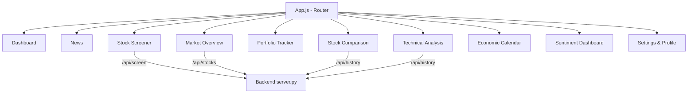

# QuantDesk — 8 New Pages Implementation Plan

Adding Market Overview, Stock Screener, Portfolio Tracker, Stock Comparison, Technical Analysis, Economic Calendar, Sentiment Dashboard, and Settings & Profile pages to the existing QuantDesk application.

## Architecture Overview

The existing app is a **monolithic single-file React app** (`App.js` ~1154 lines) with inline styles, using a `activeView` string state for page routing (`"dashboard"` | `"news"`). We'll extend this pattern by:

1. **Creating each page as a separate `.js` file** in `frontend/src/pages/` to avoid an unmanageable monolith
2. **Adding one new backend endpoint** (`/api/screen`) for the Stock Screener
3. **Extending the nav bar** with all 10 pages (Dashboard, News + 8 new)
4. **Sharing common components** (GlassPanel, StatBox, Spinner, etc.) by extracting them to `frontend/src/components/`

## User Review Required

> [!IMPORTANT]
> **Navigation Redesign**: With 10 pages, the current top-bar pill navigation won't scale. I plan to convert the nav to a **compact icon sidebar on the left** (collapsed by default, ~56px wide) that replaces the current watchlist sidebar when on non-dashboard pages. On the Dashboard page, the watchlist sidebar is preserved as-is.

> [!WARNING]
> **File Refactoring**: To keep things manageable, shared components (GlassPanel, StatBox, Spinner, Background, GlobalStyles, etc.) will be extracted into `components/SharedComponents.js`. This means `App.js` will import from it. The change is non-breaking but touches the core file significantly.

## Open Questions

> [!IMPORTANT]
> **Sentiment Dashboard — CNN Fear & Greed API**: The CNN Fear & Greed index API is unofficial and may be unreliable. I'll implement it with a fallback to a simulated gauge based on VIX levels. Is that acceptable?

> [!IMPORTANT]
> **Economic Calendar — RSS Feed**: For economic data (Fed meetings, CPI/GDP), I'll use a static curated calendar for known 2026 dates + yfinance `ticker.calendar` for earnings. There's no single reliable free RSS feed for all economic events. Should I use hardcoded known dates for Fed/CPI/GDP?

---

## Proposed Changes

### Component Extraction

Extract shared components from `App.js` into a reusable module so all pages can import them.

#### [NEW] [SharedComponents.js](file:///c:/Users/karthik/OneDrive/Documents/git-demo/PROJECT/quantdesk_test/frontend/src/components/SharedComponents.js)

Exports: `GlassPanel`, `StatBox`, `Spinner`, `CustomTooltip`, `Background`, `GlobalStyles`, `NavPill`, `Ticker`, `SearchBar`, `SidebarSkeleton`, `API`, `ML_API`, `AGENT_API`

---

### Navigation Overhaul

#### [MODIFY] [App.js](file:///c:/Users/karthik/OneDrive/Documents/git-demo/PROJECT/quantdesk_test/frontend/src/App.js)

- Extend `activeView` state to include: `"dashboard"`, `"news"`, `"market"`, `"screener"`, `"portfolio"`, `"comparison"`, `"technical"`, `"calendar"`, `"sentiment"`, `"settings"`
- Replace the 2-pill nav with an icon-based nav row in the top bar
- Import and render each page component conditionally
- Pass `dark`, `stocks`, `watchlist`, and setter functions as props to child pages

---

### Page 3: Market Overview

#### [NEW] [MarketOverview.js](file:///c:/Users/karthik/OneDrive/Documents/git-demo/PROJECT/quantdesk_test/frontend/src/pages/MarketOverview.js)

- **Sector Heatmap**: Colour-coded tiles (11 GICS sectors) showing % change. Uses yfinance sector ETFs (XLK, XLF, XLE, XLV, XLY, XLP, XLI, XLB, XLRE, XLU, XLC) fetched via `/api/stocks`
- **Major Indices**: S&P 500 (^GSPC), NASDAQ (^IXIC), DOW (^DJI), VIX (^VIX) cards
- **Top Gainers/Losers**: Table of top 5 gainers and losers from the watchlist + major stocks
- **Market Breadth**: Advance/decline ratio visual bar

Data source: All from existing `/api/stocks` endpoint with custom symbol lists. No new backend needed.

---

### Page 4: Stock Screener

#### [NEW] [StockScreener.js](file:///c:/Users/karthik/OneDrive/Documents/git-demo/PROJECT/quantdesk_test/frontend/src/pages/StockScreener.js)

- Filter panel: Sector dropdown, P/E range slider, Market Cap range, % Change range, Volume threshold
- Results table with sortable columns (Symbol, Name, Price, Change%, P/E, Mkt Cap, Volume, Sector)
- Click row to navigate to Dashboard for that ticker

#### [MODIFY] [server.py](file:///c:/Users/karthik/OneDrive/Documents/git-demo/PROJECT/quantdesk_test/backend/server.py)

Add `/api/screen` endpoint:
- Accepts query params: `sector`, `pe_min`, `pe_max`, `cap_min`, `cap_max`, `change_min`, `change_max`, `vol_min`
- Uses predefined sector ticker lists (top ~10 stocks per sector)
- Fetches via yfinance in parallel, filters, returns sorted results

---

### Page 5: Portfolio Tracker

#### [NEW] [PortfolioTracker.js](file:///c:/Users/karthik/OneDrive/Documents/git-demo/PROJECT/quantdesk_test/frontend/src/pages/PortfolioTracker.js)

- **Add Holding Form**: Ticker input (with search), quantity, buy price
- **Holdings Table**: Ticker, Qty, Buy Price, Current Price, P&L, P&L%, Allocation%
- **Summary Cards**: Total Value, Total P&L, Today's Gain/Loss, Best/Worst Performer
- **Allocation Pie Chart**: Built with Recharts `PieChart`
- **Storage**: `localStorage` key `qd_portfolio`

No backend needed — fetches current prices via existing `/api/stocks`.

---

### Page 6: Stock Comparison

#### [NEW] [StockComparison.js](file:///c:/Users/karthik/OneDrive/Documents/git-demo/PROJECT/quantdesk_test/frontend/src/pages/StockComparison.js)

- **Ticker Picker**: Select 2–4 tickers from search
- **Normalised Price Chart**: Overlay line charts (base = 100) using `/api/history`
- **Comparison Table**: P/E, EPS, Market Cap, Revenue, Profit Margin side by side
- Uses existing `/api/history` and `/api/stocks` endpoints

---

### Page 7: Technical Analysis

#### [NEW] [TechnicalAnalysis.js](file:///c:/Users/karthik/OneDrive/Documents/git-demo/PROJECT/quantdesk_test/frontend/src/pages/TechnicalAnalysis.js)

- **Full-screen chart** for a single ticker
- **Toggleable overlays**: RSI (14), MACD, Bollinger Bands, Volume bars, EMA ribbons (8, 21, 55)
- **Indicator panel**: Toggle buttons for each overlay
- **Calculations**: All done client-side from raw OHLCV data

#### [MODIFY] [server.py](file:///c:/Users/karthik/OneDrive/Documents/git-demo/PROJECT/quantdesk_test/backend/server.py)

Modify `/api/history/<symbol>` to also return `open`, `high`, `low` fields (currently only returns `date`, `price`, `volume`). This is needed for Bollinger Bands, MACD, and other indicators.

---

### Page 8: Economic Calendar

#### [NEW] [EconomicCalendar.js](file:///c:/Users/karthik/OneDrive/Documents/git-demo/PROJECT/quantdesk_test/frontend/src/pages/EconomicCalendar.js)

- **Weekly Calendar Grid**: Mon–Fri columns showing events per day
- **Earnings Dates**: From yfinance `ticker.calendar` for watchlist stocks (fetched via a new lightweight endpoint or client-side)
- **Fed/CPI/GDP Dates**: Hardcoded known 2026 schedule (Fed meets 8x/year, CPI monthly, GDP quarterly — all dates are publicly available)
- **Event Cards**: Color-coded by type (earnings = gold, Fed = blue, economic = purple)

#### [MODIFY] [server.py](file:///c:/Users/karthik/OneDrive/Documents/git-demo/PROJECT/quantdesk_test/backend/server.py)

Add `/api/earnings` endpoint that fetches upcoming earnings dates for given symbols using `yf.Ticker(symbol).calendar`.

---

### Page 9: Sentiment Dashboard

#### [NEW] [SentimentDashboard.js](file:///c:/Users/karthik/OneDrive/Documents/git-demo/PROJECT/quantdesk_test/frontend/src/pages/SentimentDashboard.js)

- **Fear & Greed Gauge**: Animated semi-circle gauge. Will attempt CNN API, fallback to VIX-based calculation
- **VIX Chart**: Line chart of VIX using `/api/history/^VIX`
- **Put/Call Ratio**: Display card (derived from VIX level as proxy — actual CBOE data requires paid API)
- **Sentiment Word Cloud**: Generated from news headlines (uses existing `/api/news` data, renders words sized by frequency)
- **Market Mood Indicators**: Bull/Bear visual meters

---

### Page 10: Settings & Profile

#### [NEW] [Settings.js](file:///c:/Users/karthik/OneDrive/Documents/git-demo/PROJECT/quantdesk_test/frontend/src/pages/Settings.js)

- **Display Name**: Text input, saved to `localStorage` (`qd_user`)
- **Theme Toggle**: Dark/Light switch (already exists, wired in)
- **Default Watchlist**: Editable list of default tickers
- **Default Time Range**: Dropdown (14d, 30d, 60d, 90d)
- **ML Feature Toggles**: Show/hide forecast, show/hide AI chat, show/hide model report
- All settings saved to `localStorage` key `qd_settings`

---

## Verification Plan

### Automated Tests
- Run `npm start` and visually verify each page renders without console errors
- Verify backend endpoint `/api/screen` returns correct filtered data
- Verify `/api/history` returns OHLCV data
- Verify `/api/earnings` returns calendar data
- Test localStorage persistence for Portfolio and Settings

### Manual Verification
- Navigate through all 10 pages using the nav bar
- Test dark/light mode on every page
- Add holdings to portfolio tracker, verify P&L calculations
- Run stock screener with various filters
- Compare 3 stocks and verify normalised chart
- Toggle technical indicators on/off
- Check economic calendar shows correct week
- Verify settings persist across page refreshes
